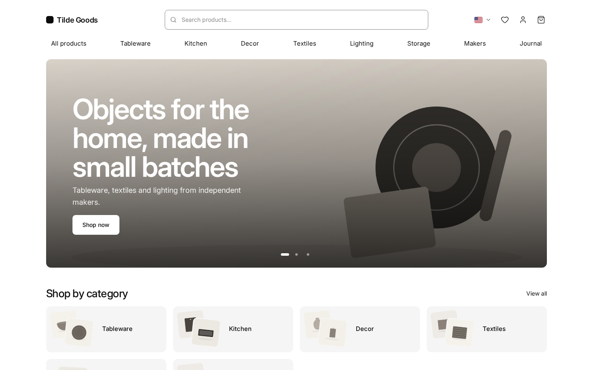
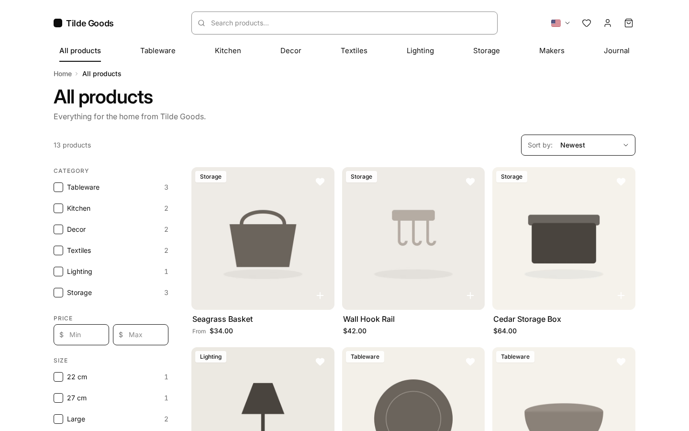
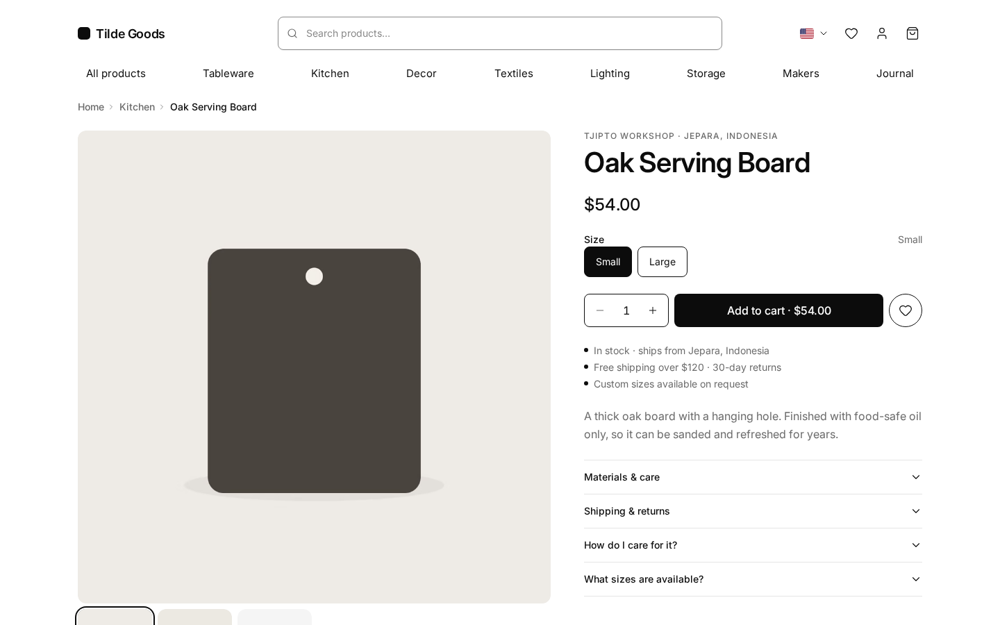
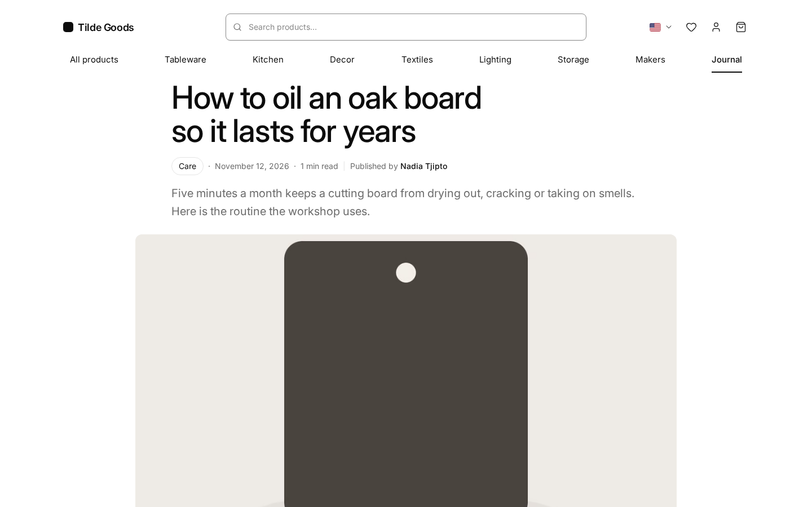

# Kiln

Tema storefront open source untuk [Medusa](https://medusajs.com) 2.x: Next.js 16 (App Router, server component,
ISR), Tailwind CSS v4, dan HeroUI v3. Hitam di atas putih, satu font, banyak ruang: foto produk yang bicara.

Dibuat [Haus Kayu](https://hauskayu.com) untuk tokonya sendiri dan dibagikan sebagai template. MIT.
English: [README.md](README.md).

| Beranda | Daftar produk | Produk | Jurnal |
| --- | --- | --- | --- |
|  |  |  |  |

## Isinya

- **Katalog**: beranda (hero promo terjadwal, tile kategori, deretan produk, blok jurnal), daftar produk untuk
  seluruh toko, kategori, dan koleksi dengan filter tanpa mesin pencari (harga, opsi, atribut metadata, pembuat,
  rating, stok, urutan: semuanya query URL biasa), halaman produk (galeri, kotak beli, bar lengket di HP, akordeon,
  spesifikasi dari metadata, ulasan, produk lain dari pembuat yang sama), quick view, pencarian.
- **Belanja**: cart drawer dan halaman keranjang, checkout tiga langkah (alamat, pengiriman, pembayaran), Payment
  Element Stripe (kartu, dompet digital, metode redirect), konfirmasi pesanan, akun pelanggan (pesanan, alamat,
  profil, ulasan), wishlist untuk tamu dan pelanggan.
- **Konten**: jurnal dengan kategori, paginasi, daftar isi, blok FAQ, kartu produk "Dari toko", baris bagikan,
  kotak penulis, RSS, dan pratinjau rahasia, lewat [medusa-blog-seo](https://www.npmjs.com/package/medusa-blog-seo).
  Halaman informasi (pengiriman, pengembalian, kontak, privasi, syarat, tentang) berupa file markdown per bahasa,
  dan halaman pembuat (daftar + profil dengan cerita dan produk) dari koleksi Medusa.
- **Market**: beberapa region Medusa sebagai market dengan bahasa, mata uang, dan prefix URL masing-masing. Market
  utama bisa di `/` (yang lain di `/id/…`), atau semua market pakai prefix seperti starter resmi. Konten produk
  datang sudah diterjemahkan dari Translation Module Medusa; teks UI tersedia dalam bahasa Inggris dan Indonesia.
- **SEO**: metadata dan canonical/hreflang di tiap halaman, JSON-LD (Organization, WebSite, Product,
  BreadcrumbList, Article, FAQ), sitemap dengan alternatif bahasa dan gambar, robots yang menerima crawler AI,
  gambar share yang digenerate (`/og/…`), halaman produk versi Markdown untuk agen (`/products/x.md`), `llms.txt` dan `llms-full.txt` (deskripsi toko untuk asisten AI:
  market, kategori, pembuat, halaman informasi, jurnal, semua produk dengan harga per market), saklar
  pra-peluncuran yang menahan seluruh situs noindex sampai `SITE_LIVE=true`.
- **Cepat**: halaman statis diregenerasi tiap menit dan dibersihkan sesuai permintaan (`/api/revalidate`, cache
  tag Cloudflare), satu file font self-host (Inter, 40 KB) dengan fallback metrik, ukuran gambar eksplisit,
  JavaScript klien minim. Lighthouse (mobile, build produksi lokal): lihat [docs/lighthouse.md](docs/lighthouse.md).
- **Integrasi opsional nyala sendiri**: ulasan dan wishlist
  ([medusa-reviews-wishlist](https://www.npmjs.com/package/medusa-reviews-wishlist)), jurnal (medusa-blog-seo),
  dan route Meilisearch dicek sekali saat start; backend tanpa semua itu mendapat storefront tanpa hati, bintang,
  atau tautan jurnal, dan pencarian jatuh ke pencarian bawaan Medusa.
- **Satu file konfigurasi**: `theme.config.ts` memuat brand, logo, profil sosial, market, warna, radius, permukaan
  blur, font, saklar fitur, filter daftar produk, catatan produk, slide hero, dan kontak. Tiap warna dan radius
  jadi CSS variable, jadi tampilan berubah tanpa menyentuh komponen. Lihat [docs/customize.md](docs/customize.md)
  (bahasa Inggris).

## Prasyarat

- Node 22+, pnpm 10.
- Backend Medusa 2.22+ dengan minimal satu region, satu sales channel, dan satu publishable API key. Seed demo
  (`seed/`) membuat semuanya untuk studio fiktif Tilde Goods di dua market (USD dan IDR).
- Opsional: `medusa-reviews-wishlist` ≥ 0.1.2, `medusa-blog-seo` ≥ 0.1.3, kunci Stripe, route
  `/store/meilisearch/products` di backend (kontraknya di `src/lib/data/search.ts`).

## Mulai cepat

```bash
# 1. Backend (proyek Medusa 2.22+ apa saja). Plugin opsional di medusa-config.ts:
#    { resolve: "medusa-blog-seo", options: { storefront_url: "http://localhost:9720" } },
#    { resolve: "medusa-reviews-wishlist", options: { storefront_url: "http://localhost:9720" } },
#    Katalog demo (dua region, sales channel + key, kategori, 13 produk):
cp seed/seed-kiln.ts <backend>/src/scripts/ && mkdir -p <backend>/static/demo && cp seed/images/*.jpg <backend>/static/demo/
cd <backend> && npx medusa exec ./src/scripts/seed-kiln.ts     # mencetak publishable key

# 2. Storefront
cp .env.example .env            # URL backend, publishable key, origin situs
pnpm install
pnpm dev                        # http://localhost:9720
```

Kunci `.env`: `NEXT_PUBLIC_MEDUSA_BACKEND_URL` (dan `MEDUSA_BACKEND_URL_INTERNAL` kalau server mencapai Medusa lewat
alamat lain), `NEXT_PUBLIC_MEDUSA_PUBLISHABLE_KEY`, `NEXT_PUBLIC_BASE_URL`, opsional `NEXT_PUBLIC_MEDIA_URL`,
`MEILISEARCH_HOST` / `MEILISEARCH_SEARCH_KEY`, `NEXT_PUBLIC_STRIPE_KEY`, `REVALIDATE_SECRET`, `SITE_LIVE`,
`KILN_FEATURE_*`. Artikel demo: `node seed/seed-blog.mjs` setelah backend jalan dengan medusa-blog-seo.

Produksi: `pnpm build` menghasilkan server standalone (`.next/standalone`, `output: "standalone"`); jalankan dengan
`node .next/standalone/server.js` di belakang reverse proxy atau CDN apa pun. `SITE_LIVE` dan `NEXT_PUBLIC_*`
dibaca saat build.

## Pembayaran

Checkout menampilkan provider pembayaran yang aktif di region. Stripe merender Payment Element di dalam
opsinya dan mengonfirmasi PaymentIntent saat "Buat pesanan"; `pp_system_default` Medusa ("Bayar nanti", untuk
pengembangan) dan provider lain yang selesai cukup dengan "Buat pesanan" langsung jalan. Provider yang butuh
layar sendiri (kode QR, instruksi bank, redirect) mendapat komponen di
`src/modules/checkout/components/payment.tsx` di samping komponen Stripe. Dua plugin dari pembuat yang sama
membawa komponen storefront-nya sendiri:
[medusa-payment-doit](https://www.npmjs.com/package/medusa-payment-doit) (QRIS dan virtual account, Indonesia)
dan [medusa-payment-manual-transfer](https://www.npmjs.com/package/medusa-payment-manual-transfer) (transfer bank
dengan halaman pembayaran).

Stripe di backend (`medusa-config.ts`):

```ts
{
  resolve: "@medusajs/medusa/payment",
  options: {
    providers: [
      {
        resolve: "@medusajs/medusa/payment-stripe",
        id: "stripe",
        options: { apiKey: process.env.STRIPE_API_KEY, webhookSecret: process.env.STRIPE_WEBHOOK_SECRET, capture: true },
      },
    ],
  },
}
```

Aktifkan provider di region lewat Admin → Settings → Regions, isi publishable key di `NEXT_PUBLIC_STRIPE_KEY`,
dan arahkan webhook Stripe ke `<backend>/hooks/payment/stripe_stripe`.

## Folder

```
theme.config.ts        brand, market, warna, radius, font, fitur, daftar produk, hero, kontak
src/app/[countryCode]  halaman: (main) home, store, categories, collections, products, search, cart, wishlist,
                       blog, account, order, design; (checkout)
src/app/api            cart, health, payment-return, revalidate, reviews, wishlist
src/app/og             gambar share yang digenerate
src/modules/ds         design system (kartu, grid, section, harga, bintang, sheet, carousel)
src/modules/*          home, layout, products, store, cart, checkout, account, order, blog, wishlist, brand
src/lib                data (Medusa SDK), i18n, filter daftar produk, seo, util, features.ts
src/styles             globals.css (token, skala tipografi, utility), theme.css (pemetaan HeroUI), font
seed                   katalog demo, artikel, dan gambar hasil generate (CC0)
docs                   customize.md, lighthouse.md, rencana, mockup, screenshot
```

## Status

Kiln masih muda. Belum ada di tema: halaman lacak pesanan, resizer gambar produk (gambar disajikan apa adanya
oleh backend), dan feed Google Merchant. Jurnal dan tab ulasan di akun butuh plugin masing-masing.

## Pengembangan

[CONTRIBUTING.md](CONTRIBUTING.md) (bahasa Inggris) menjelaskan setup lokal, konten demo, pengujian Stripe, cara
menguji storefront dengan integrasi opsional dimatikan, dan pemeriksaan sebelum commit (`pnpm typecheck`,
`pnpm lint`).

## Docker

`Dockerfile` membangun server standalone (port 8000). Halaman statis dirender saat build, jadi backend harus bisa
diakses saat itu: `docker build --network host --build-arg NEXT_PUBLIC_MEDUSA_PUBLISHABLE_KEY=pk_… 
--build-arg NEXT_PUBLIC_MEDUSA_BACKEND_URL=https://api.contoh.com --build-arg NEXT_PUBLIC_BASE_URL=https://toko.contoh.com 
--build-arg MEDUSA_BACKEND_URL_INTERNAL=http://127.0.0.1:9000 --build-arg SITE_LIVE=true -t kiln .`
Jalankan dengan `MEDUSA_BACKEND_URL_INTERNAL` yang sama (plus `REVALIDATE_SECRET`, `NEXT_PUBLIC_STRIPE_KEY` bila
dipakai). `KILN_DEMO_NOTICE=true` menampilkan satu baris pemberitahuan "toko demo" di atas header.

## Sponsor

Tema ini gratis (MIT) dan dirawat oleh workshop furnitur kecil di Jepara. Kalau tema ini menghemat waktu kamu,
[dukung Haus Kayu lewat GitHub Sponsors](https://github.com/sponsors/haustex).

### Sponsor bisnis

_Logo kamu di sini. [Jadi sponsor Business](https://github.com/sponsors/haustex) ($50/bulan)._

### Backer

_Nama kamu di sini. [Jadi Backer](https://github.com/sponsors/haustex) ($10/bulan)._

## Lisensi

MIT. Font, ikon, dan starter Medusa yang jadi asal tema ini dicatat di
[THIRD_PARTY_NOTICES.md](THIRD_PARTY_NOTICES.md). Brand demo Tilde Goods, para pembuatnya, dan gambarnya fiktif dan
hasil generate (CC0). Baris kredit di footer ("Theme Kiln by Haus Kayu") opsional: `brand.credit: false` di
`theme.config.ts`.
