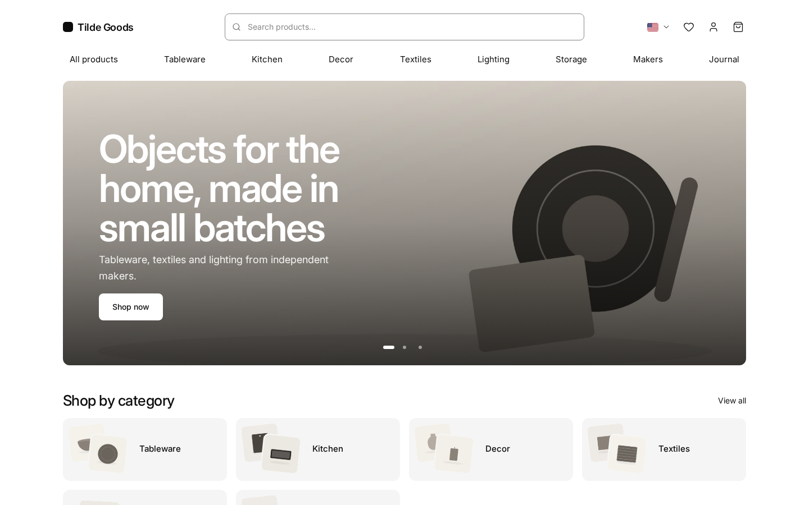
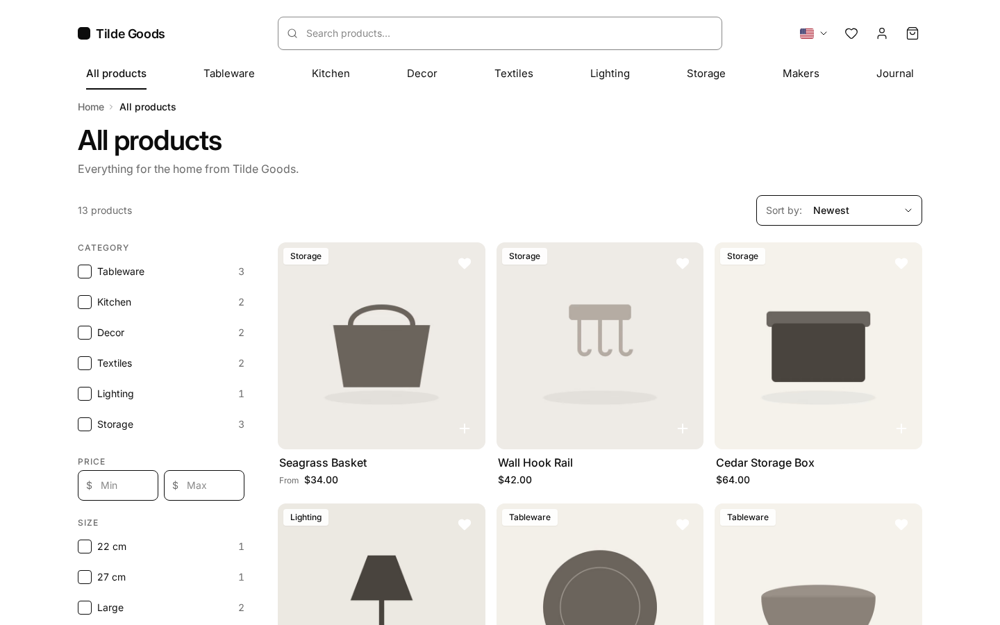
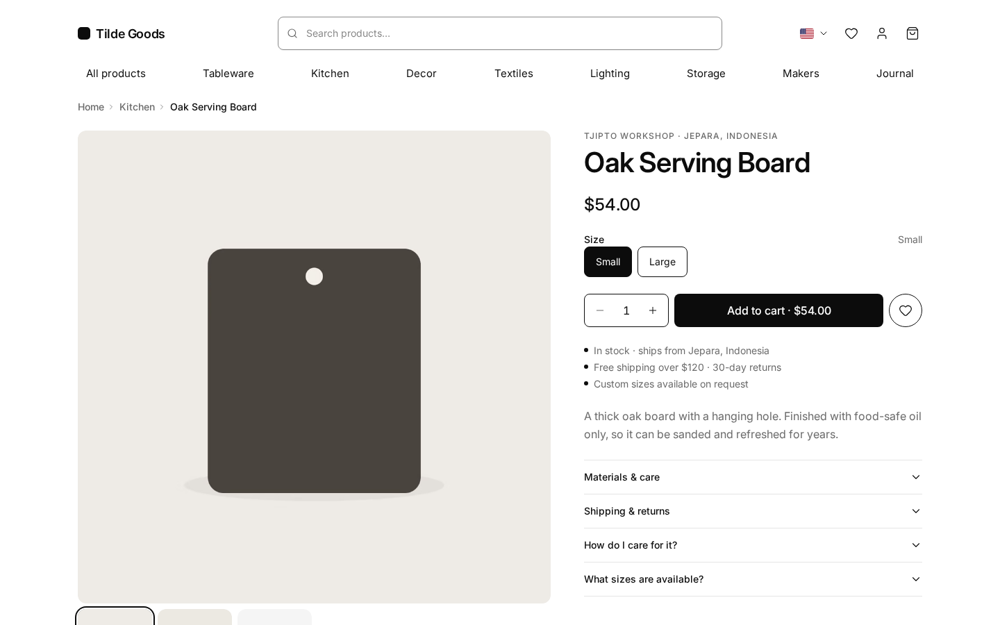
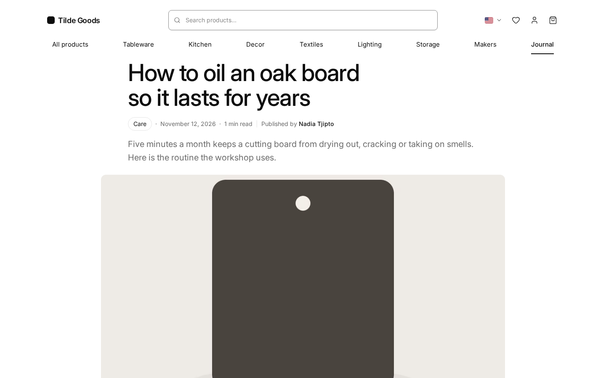

# Kiln

An open-source storefront theme for [Medusa](https://medusajs.com) 2.x: Next.js 16 (App Router, server components,
ISR), Tailwind CSS v4 and HeroUI v3. Black on white, one font, a lot of air: the product photos do the talking.

Built by [Haus Kayu](https://hauskayu.com) for its own shop and shared as a template. MIT.
Bahasa Indonesia: [README.id.md](README.id.md).

Demo: [kiln.hauskayu.com](https://kiln.hauskayu.com) (Stripe test mode, the data is reset every night).

| Home | Listing | Product | Journal |
| --- | --- | --- | --- |
|  |  |  |  |

## What you get

- **Catalogue**: home (promo hero with schedule, category tiles, product rails, journal band), listings for the whole
  store, categories and collections with filters that need no search engine (price, options, metadata attributes,
  maker, rating, stock, sort: all plain URL queries), product page (gallery, buy box, sticky bar on phones,
  accordions, specifications from metadata, reviews, more from the maker), quick view, search.
- **Shopping**: cart drawer and cart page, checkout in three steps (address, delivery, payment), Stripe's Payment
  Element (card, wallets, redirect methods), order confirmation, customer account (orders, addresses, profile,
  reviews), wishlist for guests and customers.
- **Content**: a journal with categories, pagination, table of contents, FAQ blocks, "from the shop" product
  cards, share row, author box, RSS feed and secret previews, through [medusa-blog-seo](https://www.npmjs.com/package/medusa-blog-seo).
  Information pages (shipping, returns, contact, privacy, terms, about) as markdown files per language, and
  maker pages (list + profile with story and products) built from Medusa collections.
- **Markets**: several Medusa regions as markets with their own language, currency and URL prefix. The default
  market can live at `/` (the others at `/id/…`), or every market can keep its prefix like the official starter.
  Product content comes translated from Medusa's Translation Module; the UI strings ship in English and Indonesian.
- **SEO**: metadata and canonical/hreflang on every page, JSON-LD (Organization, WebSite, Product, BreadcrumbList,
  Article, FAQ), sitemap with language alternates and images, robots that welcome AI crawlers, generated share
  images (`/og/…`), product pages as Markdown for agents (`/products/x.md`), `llms.txt` and `llms-full.txt`
  (the store described for AI assistants: markets, categories, makers, information pages, journal, every product
  with prices per market), a pre-launch switch that keeps the whole site noindex until `SITE_LIVE=true`.
- **Speed**: static pages regenerated every minute and purged on demand (`/api/revalidate`, Cloudflare cache
  tags), one self-hosted font file (Inter, 40 KB) with metric fallbacks, explicit image sizes, little client-side
  JavaScript. Lighthouse (mobile, local production build): see [docs/lighthouse.md](docs/lighthouse.md).
- **Optional integrations switch themselves on**: reviews and wishlist
  ([medusa-reviews-wishlist](https://www.npmjs.com/package/medusa-reviews-wishlist)), the journal
  (medusa-blog-seo) and a Meilisearch route are probed once at start; a backend without them gets a storefront
  without hearts, stars or a journal link, and search falls back to Medusa's own.
- **One config file**: `theme.config.ts` holds the brand, logo, social profiles, markets, colours, radii, frosted
  surfaces, font, feature switches, listing filters, product notes, hero slides and contact. Every colour and
  radius becomes a CSS variable, so the whole look changes without touching a component.
  See [docs/customize.md](docs/customize.md).

## Requirements

- Node 22+, pnpm 10.
- A Medusa 2.22+ backend with at least one region, a sales channel and a publishable API key. The demo seed
  (`seed/`) creates all of it for a fictional studio, Tilde Goods, in two markets (USD and IDR).
- Optional: `medusa-reviews-wishlist` ≥ 0.1.2, `medusa-blog-seo` ≥ 0.1.3, Stripe keys,
  `medusa-payment-manual-transfer` ≥ 0.1.4, `medusa-payment-doit` ≥ 0.1.5 (see Payments),
  `medusa-fulfillment-zone-rate` ≥ 0.3.2 (see Shipping), a
  `/store/meilisearch/products` route in the backend (see `src/lib/data/search.ts` for the contract).

## Quick start

```bash
# 1. The backend (any Medusa 2.22+ project). Optional plugins in medusa-config.ts:
#    { resolve: "medusa-blog-seo", options: { storefront_url: "http://localhost:9720" } },
#    { resolve: "medusa-reviews-wishlist", options: { storefront_url: "http://localhost:9720" } },
#    Demo catalogue (two regions, a sales channel + key, categories, 13 products):
cp seed/seed-kiln.ts <backend>/src/scripts/ && mkdir -p <backend>/static/demo && cp seed/images/*.jpg <backend>/static/demo/
cd <backend> && npx medusa exec ./src/scripts/seed-kiln.ts     # prints the publishable key

# 2. The storefront
cp .env.example .env            # backend URL, publishable key, site origin
pnpm install
pnpm dev                        # http://localhost:9720
```

`.env` keys: `NEXT_PUBLIC_MEDUSA_BACKEND_URL` (and `MEDUSA_BACKEND_URL_INTERNAL` when the server reaches Medusa on
another address), `NEXT_PUBLIC_MEDUSA_PUBLISHABLE_KEY`, `NEXT_PUBLIC_BASE_URL`, optional `NEXT_PUBLIC_MEDIA_URL`,
`MEILISEARCH_HOST` / `MEILISEARCH_SEARCH_KEY`, `NEXT_PUBLIC_STRIPE_KEY`, `MANUAL_TRANSFER_PROXY_SECRET`,
`NEXT_PUBLIC_DOIT_REDIRECT_TO_HOSTED`, `ZONE_RATE_PROXY_SECRET`, `REVALIDATE_SECRET`, `SITE_LIVE`, `KILN_FEATURE_*`. Demo articles: `node seed/seed-blog.mjs` once the backend runs with medusa-blog-seo.

Production: `pnpm build` produces a standalone server (`.next/standalone`, `output: "standalone"`); run it with
`node .next/standalone/server.js` behind any reverse proxy or CDN. `SITE_LIVE` and `NEXT_PUBLIC_*` are read at
build time.

## Payments

Checkout lists the payment providers enabled on the region; Medusa's `pp_system_default` ("Pay later", for
development) and any provider that completes with "Place order" alone work as they are. Three providers have their
own screens built in, each switched on by nothing more than the backend having it:

| Provider | Backend | In Kiln |
| --- | --- | --- |
| **Stripe** (`pp_stripe_*`) | `@medusajs/medusa/payment-stripe`, `STRIPE_API_KEY` | Payment Element inside the option (card, wallets, redirect methods back through `/api/payment-return`); `NEXT_PUBLIC_STRIPE_KEY` in `.env` |
| **Bank transfer** (`pp_manual-transfer_manual-transfer`) | [medusa-payment-manual-transfer](https://www.npmjs.com/package/medusa-payment-manual-transfer) | "Place order" creates the order and opens `/transfer/{order}?token=…`: bank details, reference, deadline, pro-forma invoice, proof upload (also from the account's order page); set `MANUAL_TRANSFER_PROXY_SECRET` in both `.env` files |
| **QRIS / Virtual Account** (`pp_doit_doit`, IDR) | [medusa-payment-doit](https://www.npmjs.com/package/medusa-payment-doit) | method picker with fees, then the QR code or VA number with countdown and polling; the order is placed when doit.id confirms. Credentials in Admin → Settings → doit.id |

The plugin texts are in English and Indonesian and follow the market's language. A provider of your own gets a
branch in `src/modules/checkout/components/payment.tsx` next to these (docs/customize.md, "Payment providers").

Backend side (`medusa-config.ts`), all three together:

```ts
plugins: [
  { resolve: "medusa-payment-manual-transfer", options: { notifications: { paymentUrl: "https://your-store.com/transfer/{order_id}?token={token}" } } },
  { resolve: "medusa-payment-doit", options: {} },
],
modules: [
  {
    resolve: "@medusajs/medusa/payment",
    options: {
      providers: [
        { resolve: "@medusajs/medusa/payment-stripe", id: "stripe", options: { apiKey: process.env.STRIPE_API_KEY, webhookSecret: process.env.STRIPE_WEBHOOK_SECRET, capture: true } },
        { resolve: "medusa-payment-manual-transfer/providers/manual-transfer", id: "manual-transfer", options: { referencePrefix: "MT", deadlineBusinessDays: 3, timezone: "Asia/Jakarta" } },
        { resolve: "medusa-payment-doit/providers/doit", id: "doit", options: {} },
      ],
    },
  },
]
```

Then `medusa db:migrate`, enable each provider on its regions (Admin → Settings → Regions, or
`node seed/enable-payments.mjs` for the demo), a bank account in Settings → Manual transfer, a Stripe webhook at
`<backend>/hooks/payment/stripe_stripe` and the doit.id webhook at `<backend>/hooks/payment/doit_doit`. Secrets:
`STRIPE_API_KEY`, `MANUAL_TRANSFER_SECRET`, `MANUAL_TRANSFER_PROXY_SECRET`, `DOIT_ENCRYPTION_KEY` (each plugin's
README has the details).

## Shipping

With [medusa-fulfillment-zone-rate](https://www.npmjs.com/package/medusa-fulfillment-zone-rate) in the backend
(calculated rates by zone and chargeable weight, shipments with tracking numbers and e-mails) checkout shows each
option's delivery estimate and the plugin's own message when it refuses an address or a product without a size,
the product page says how long delivery takes after dispatch, `{{rates}}` on the shipping page prints the rate
card, `/track` (Indonesian: `/lacak`) is a live tracking page and the account's order page lists the shipments
with their timeline and photos. Nothing to configure in the theme beyond `ZONE_RATE_PROXY_SECRET`; details in
docs/customize.md "Shipping and tracking". `seed/enable-shipping.mjs` switches it on for the demo backend.

## Folders

```
theme.config.ts        brand, markets, colours, radii, font, features, listing, hero, contact
src/app/[countryCode]  pages: (main) home, store, categories, collections, products, search, cart, wishlist,
                       blog, account, order, design; (checkout)
src/app/api            cart, health, payment-return, manual-transfer (proof/invoice relay), zone-rate (tracking relay), revalidate, reviews, wishlist
src/app/og             generated share images
src/modules/ds         the design system (cards, grids, sections, price, stars, sheet, carousel)
src/modules/*          home, layout, products, store, cart, checkout (+ doit), manual-transfer, tracking, shipping, account, order, blog, wishlist, brand
src/lib                data (Medusa SDK), i18n, listing filters, seo, util, features.ts
src/styles             globals.css (tokens, type scale, utilities), theme.css (HeroUI mapping), fonts
seed                   demo catalogue, articles and generated images (CC0)
docs                   customize.md, lighthouse.md, plan, mockups, screenshots
```

## Status

Kiln is young. Not in the theme yet: an order-tracking page, a product image resizer (images are served by the
backend as they are) and a Google Merchant feed. The journal and the account's review tab need their plugins.

## Development

[CONTRIBUTING.md](CONTRIBUTING.md) describes the local setup, the demo content, the Stripe test setup, how to
test the storefront with the optional integrations switched off, and the checks before a commit
(`pnpm typecheck`, `pnpm lint`).

## Docker or Vercel

On Vercel import the repository, set the environment variables and add the domain: [docs/deploy-vercel.md](docs/deploy-vercel.md).

`Dockerfile` builds the standalone server (port 8000). The static pages are rendered during the build, so the
backend must be reachable then: `docker build --network host --build-arg NEXT_PUBLIC_MEDUSA_PUBLISHABLE_KEY=pk_… 
--build-arg NEXT_PUBLIC_MEDUSA_BACKEND_URL=https://api.example.com --build-arg NEXT_PUBLIC_BASE_URL=https://shop.example.com 
--build-arg MEDUSA_BACKEND_URL_INTERNAL=http://127.0.0.1:9000 --build-arg SITE_LIVE=true -t kiln .`
Run it with the same `MEDUSA_BACKEND_URL_INTERNAL` (and `REVALIDATE_SECRET`, `NEXT_PUBLIC_STRIPE_KEY` when used).
`KILN_DEMO_NOTICE=true` shows a one-line "demo store" notice above the header.

## Sponsors

This theme is free and MIT licensed, maintained by a small furniture workshop in Jepara, Indonesia. If it saves you
time, [sponsor Haus Kayu on GitHub](https://github.com/sponsors/haustex).
<br>Theme ini gratis (MIT) dan dirawat oleh workshop furnitur kecil di Jepara. Kalau theme ini menghemat waktumu,
[dukung Haus Kayu lewat GitHub Sponsors](https://github.com/sponsors/haustex).

### Business sponsors

_Your logo here. [Become a Business sponsor](https://github.com/sponsors/haustex) ($50/month)._

### Backers

_Your name here. [Become a Backer](https://github.com/sponsors/haustex) ($10/month)._

## Licence

MIT. Fonts, icons and the Medusa starter this theme grew from are credited in
[THIRD_PARTY_NOTICES.md](THIRD_PARTY_NOTICES.md). The demo brand Tilde Goods, its makers and its images are
fictional and generated (CC0). The footer credit line ("Theme Kiln by Haus Kayu") is optional:
`brand.credit: false` in `theme.config.ts`.
